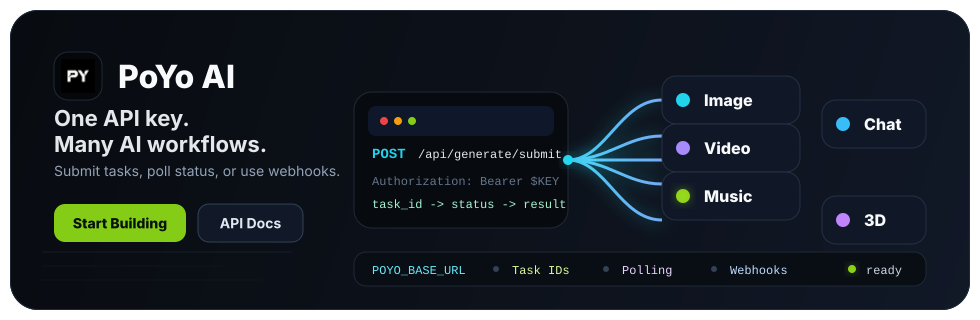

<p align="center">
  <a href="https://poyo.ai">
    
  </a>
</p>

<p align="center">
  <a href="https://poyo.ai"></a>
  <a href="https://docs.poyo.ai"></a>
  <a href="https://poyo.ai/models"></a>
  <a href="https://github.com/PoyoAPI/poyo-examples"></a>
</p>

## One API for AI model workflows

PoYo AI gives developers one production API workflow for image, video, music, chat, and 3D model generation: submit a task, store `task_id`, poll in testing, and use webhooks in production.

Start with [PoyoAPI/poyo-examples](https://github.com/PoyoAPI/poyo-examples) for the full backend-safe workflow, then use focused model repos when you already know which model you want to integrate.

## Main examples repo

Use [PoyoAPI/poyo-examples](https://github.com/PoyoAPI/poyo-examples) when you want the full backend-safe path across cURL, Node.js, Python, Next.js routes, status polling, and production webhooks.

## Recent model quickstarts

Use these when you are coming from a recent model demo and want the smallest backend-safe request first.

| Model | Start here |
| --- | --- |
| Seedance 2.5 Flash | [seedance-2-5-flash-api](https://github.com/PoyoAPI/Seedance-2.5-Flash-API) ([model](https://poyo.ai/models/seedance-2-5-flash)) |
| Seedance 2.5 | [seedance-2-5-api](https://github.com/PoyoAPI/Seedance-2.5-API) ([model](https://poyo.ai/models/seedance-2-5)) |
| MiniMax H3 / Hailuo 03 | [minimax-h3-api](https://github.com/PoyoAPI/MiniMax-H3-API) ([model](https://poyo.ai/models/minimax-h3)) |
| FLUX 3 Video | [flux-3-video-api](https://github.com/PoyoAPI/FLUX-3-Video-API) ([model](https://poyo.ai/models/flux-3)) |
| Qwen Image 3 | [qwen-image-3-api](https://github.com/PoyoAPI/Qwen-Image-3-API) ([model](https://poyo.ai/models/qwen-image-3)) |
| Kimi K3 | [kimi-k3-api](https://github.com/PoyoAPI/Kimi-K3-API) ([model](https://poyo.ai/models/kimi-k3)) |
| GPT-5.6 | [gpt-5-6-api](https://github.com/PoyoAPI/GPT-5.6-API) ([model](https://poyo.ai/models/gpt-5-6)) |
| Claude Opus 5 | [claude-opus-5-api](https://github.com/PoyoAPI/Claude-Opus-5-API) ([model](https://poyo.ai/models/claude-opus-5)) |
| Seedream 5.0 Pro | [seedream-5-0-pro-api](https://github.com/PoyoAPI/Seedream-5.0-Pro-API) ([model](https://poyo.ai/models/seedream-5-0-pro)) |
| Seedance 2.0 Mini | [seedance-2-mini-api](https://github.com/PoyoAPI/Seedance-2.0-Mini-API) ([model](https://poyo.ai/models/seedance-2-mini)) |
| Wan 2.2 Fast | [wan-2-2-fast-api](https://github.com/PoyoAPI/Wan-2.2-Fast-API) ([model](https://poyo.ai/models/wan-2-2-fast)) |
| Hailuo 2.3 | [hailuo-2-3-api](https://github.com/PoyoAPI/Hailuo-2.3-API) ([model](https://poyo.ai/models/hailuo-2-3)) |
| Kling Avatar 2.0 | [kling-avatar-2-0-api](https://github.com/PoyoAPI/Kling-Avatar-2.0-API) ([model](https://poyo.ai/models/kling-avatar-2-0)) |
| Flux Kontext | [flux-kontext-api](https://github.com/PoyoAPI/Flux-Kontext-API) ([model](https://poyo.ai/models/flux-kontext)) |
| Tripo3D H3.1 | [tripo-h31-3d-api](https://github.com/PoyoAPI/Tripo3D-H3.1-API) ([model](https://poyo.ai/models/tripo-h31-3d)) |
| GPT-5.5 | [gpt-5-5-api](https://github.com/PoyoAPI/GPT-5.5-API) ([model](https://poyo.ai/models/gpt-5-5)) |
| Claude Opus 4.8 | [claude-opus-4-8-api](https://github.com/PoyoAPI/Claude-Opus-4.8-API) ([model](https://poyo.ai/models/claude-opus-4-8)) |
| Gemini 3.5 Flash | [gemini-3-5-flash-api](https://github.com/PoyoAPI/Gemini-3.5-Flash-API) ([model](https://poyo.ai/models/gemini-3-5-flash)) |
| Kling 3.0 | [kling-3-api](https://github.com/PoyoAPI/Kling-3.0-API) ([model](https://poyo.ai/models/kling-3-api)) |
| Grok Imagine Image Quality | [grok-imagine-image-quality-api](https://github.com/PoyoAPI/Grok-Imagine-Image-Quality-API) ([model](https://poyo.ai/models/grok-imagine-image-quality)) |
| FLUX.2 | [flux-2-api](https://github.com/PoyoAPI/FLUX.2-API) ([model](https://poyo.ai/models/flux-2)) |
| Seedream 5.0 Lite | [seedream-5-0-lite-api](https://github.com/PoyoAPI/Seedream-5.0-Lite-API) ([model](https://poyo.ai/models/seedream-5-0-lite-api)) |
| Hunyuan 3D 3.1 | [hunyuan-3d-3-1-api](https://github.com/PoyoAPI/Hunyuan-3D-3.1-API) ([model](https://poyo.ai/models/hunyuan-3d-3-1)) |
| Claude 4.5 | [claude-4-5-api](https://github.com/PoyoAPI/Claude-4.5-API) ([model](https://poyo.ai/models/claude-4-5-api)) |
| Runway Gen-4.5 | [runway-gen-4-5-api](https://github.com/PoyoAPI/Runway-Gen-4.5-API) ([model](https://poyo.ai/models/runway-gen-4-5)) |
| Kling O3 | [kling-o3-api](https://github.com/PoyoAPI/Kling-O3-API) ([model](https://poyo.ai/models/kling-o3-api)) |
| Wan 2.7 Video | [wan-2-7-video-api](https://github.com/PoyoAPI/Wan-2.7-Video-API) ([model](https://poyo.ai/models/wan-2-7-video)) |
| Seedream 4.5 | [seedream-4-5-api](https://github.com/PoyoAPI/Seedream-4.5-API) ([model](https://poyo.ai/models/seedream-4-5-api)) |
| Gemini 3.1 Flash TTS | [gemini-3-1-flash-tts-api](https://github.com/PoyoAPI/Gemini-3.1-Flash-TTS-API) ([model](https://poyo.ai/models/gemini-3-1-flash-tts)) |
| ElevenLabs Music | [elevenlabs-music-api](https://github.com/PoyoAPI/ElevenLabs-Music-API) ([model](https://poyo.ai/models/elevenlabs-music)) |
| Meshy 6 3D | [meshy-6-3d-api](https://github.com/PoyoAPI/Meshy-6-API) ([model](https://poyo.ai/models/meshy-6-3d)) |
| Veo 3.1 Official | [veo-3-1-official-api](https://github.com/PoyoAPI/Veo-3.1-API) |
| Gemini 3 | [gemini-3-api](https://github.com/PoyoAPI/Gemini-3-API) |
| DeepSeek V4 | [deepseek-v4-api](https://github.com/PoyoAPI/DeepSeek-V4-API) |
| Grok Imagine Video 1.5 | [grok-imagine-video-1-5-api](https://github.com/PoyoAPI/Grok-Imagine-Video-1.5-API) |
| ElevenLabs v3 TTS | [elevenlabs-v3-tts-api](https://github.com/PoyoAPI/ElevenLabs-V3-TTS-API) |
| MiniMax Music 2.6 | [minimax-music-2-6-api](https://github.com/PoyoAPI/MiniMax-Music-2.6-API) |
| Claude Sonnet 5 | [claude-sonnet-5 cURL](https://github.com/PoyoAPI/poyo-examples/blob/main/curl/chat/claude-sonnet-5.md) |
| Nano Banana 2 Lite | [nano-banana-2-lite cURL](https://github.com/PoyoAPI/poyo-examples/blob/main/curl/image/nano-banana-2-lite.md) |
| Omni Flash | [omni-flash cURL](https://github.com/PoyoAPI/poyo-examples/blob/main/curl/video/omni-flash.md) |
| Grok Imagine Image | [grok-imagine-image cURL](https://github.com/PoyoAPI/poyo-examples/blob/main/curl/image/grok-imagine-image.md) |
| Seedance 2.0 Mini | [seedance-2-mini cURL](https://github.com/PoyoAPI/poyo-examples/blob/main/curl/video/seedance-2-mini.md) |
| Kling 3.0 Turbo | [kling-3-0-turbo cURL](https://github.com/PoyoAPI/poyo-examples/blob/main/curl/video/kling-3-0-turbo.md) |

## Focused model repos

Use these when you already know the model you want and need a smaller repo to copy from.

| Category | Repository |
| --- | --- |
| Chat | [kimi-k3-api](https://github.com/PoyoAPI/Kimi-K3-API), [gpt-5-6-api](https://github.com/PoyoAPI/GPT-5.6-API), [claude-opus-5-api](https://github.com/PoyoAPI/Claude-Opus-5-API), [gpt-5-5-api](https://github.com/PoyoAPI/GPT-5.5-API), [claude-opus-4-8-api](https://github.com/PoyoAPI/Claude-Opus-4.8-API), [gemini-3-5-flash-api](https://github.com/PoyoAPI/Gemini-3.5-Flash-API) |
| Image | [qwen-image-3-api](https://github.com/PoyoAPI/Qwen-Image-3-API), [seedream-5-0-pro-api](https://github.com/PoyoAPI/Seedream-5.0-Pro-API), [flux-kontext-api](https://github.com/PoyoAPI/Flux-Kontext-API), [grok-imagine-image-quality-api](https://github.com/PoyoAPI/Grok-Imagine-Image-Quality-API), [flux-2-api](https://github.com/PoyoAPI/FLUX.2-API) |
| Video | [seedance-2-5-flash-api](https://github.com/PoyoAPI/Seedance-2.5-Flash-API), [seedance-2-5-api](https://github.com/PoyoAPI/Seedance-2.5-API), [minimax-h3-api](https://github.com/PoyoAPI/MiniMax-H3-API), [flux-3-video-api](https://github.com/PoyoAPI/FLUX-3-Video-API), [seedance-2-mini-api](https://github.com/PoyoAPI/Seedance-2.0-Mini-API), [wan-2-2-fast-api](https://github.com/PoyoAPI/Wan-2.2-Fast-API), [hailuo-2-3-api](https://github.com/PoyoAPI/Hailuo-2.3-API) |
| Music | [gemini-3-1-flash-tts-api](https://github.com/PoyoAPI/Gemini-3.1-Flash-TTS-API) ([model](https://poyo.ai/models/gemini-3-1-flash-tts)), [elevenlabs-music-api](https://github.com/PoyoAPI/ElevenLabs-Music-API) ([model](https://poyo.ai/models/elevenlabs-music)), [elevenlabs-v3-tts-api](https://github.com/PoyoAPI/ElevenLabs-V3-TTS-API), [minimax-music-2-6-api](https://github.com/PoyoAPI/MiniMax-Music-2.6-API) |
| 3D | [tripo-h31-3d-api](https://github.com/PoyoAPI/Tripo3D-H3.1-API) ([model](https://poyo.ai/models/tripo-h31-3d)), [hunyuan-3d-3-1-api](https://github.com/PoyoAPI/Hunyuan-3D-3.1-API) ([model](https://poyo.ai/models/hunyuan-3d-3-1)), [meshy-6-3d-api](https://github.com/PoyoAPI/Meshy-6-API) ([model](https://poyo.ai/models/meshy-6-3d)) |

## Example model families

| Category | Families |
| --- | --- |
| Chat |    |
| Image |     |
| Video |      |
| Music |   |
| 3D |   |

## Quickstart

1. Create an account at [poyo.ai](https://poyo.ai).
2. Create an API key in the [dashboard](https://poyo.ai/dashboard/api-key).
3. Submit a generation task.
4. Save the returned `task_id`.
5. Poll status in testing.
6. Use `callback_url` webhooks in production.

```bash
export POYO_API_KEY="your-api-key"
export POYO_BASE_URL="https://api.poyo.ai"

curl -X POST "$POYO_BASE_URL/api/generate/submit" \
  -H "Authorization: Bearer $POYO_API_KEY" \
  -H "Content-Type: application/json" \
  -d '{
    "model": "gpt-image-2",
    "input": {
      "prompt": "A clean product render of a translucent AI cube on a white studio surface",
      "size": "1:1",
      "resolution": "1K",
      "quality": "low",
      "n": 1
    }
  }'
```

## Developer resources

- Website: [poyo.ai](https://poyo.ai)
- API docs: [docs.poyo.ai](https://docs.poyo.ai)
- Models: [poyo.ai/models](https://poyo.ai/models)
- API keys: [poyo.ai/dashboard/api-key](https://poyo.ai/dashboard/api-key)
- Examples: [PoyoAPI/poyo-examples](https://github.com/PoyoAPI/poyo-examples)
- Support: [support@poyo.ai](mailto:support@poyo.ai)
